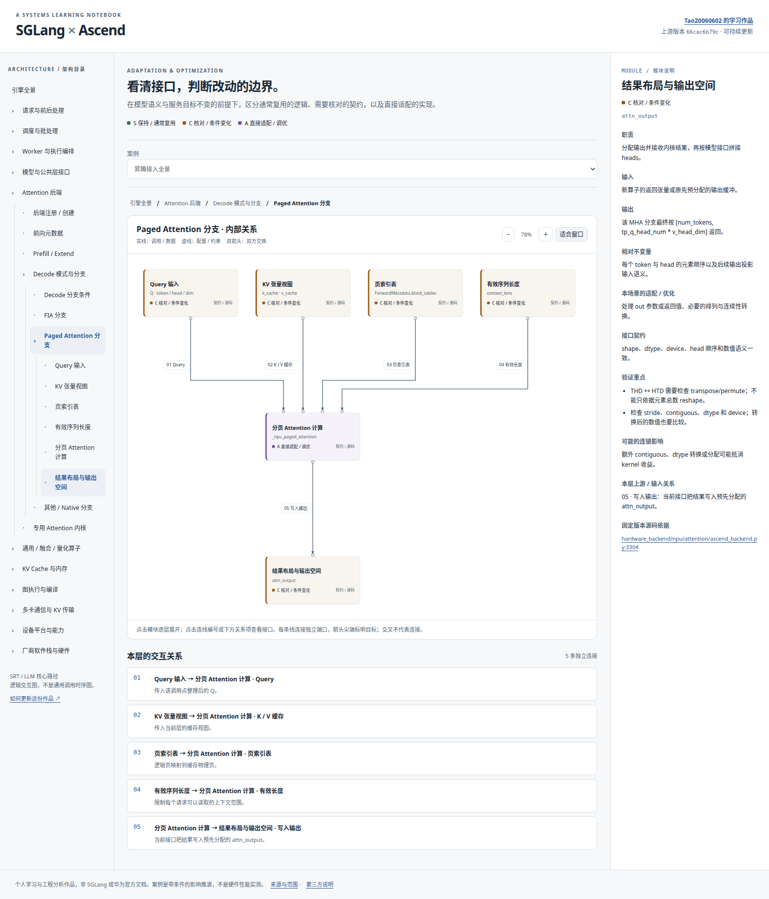

# SGLang × Ascend Explorer

**作者与维护者：[Tao20060602](https://github.com/Tao20060602)**

**[在线浏览](https://tao20060602.github.io/sglang-ascend-explorer/)** · **[完整架构图](docs/architecture.png)**

这是我的推理引擎学习作品：通过可展开的架构图，理解 SGLang 中昇腾适配的边界，以及优化带来的连锁影响。我会结合自己的源码阅读和实践继续修订。



## 可以探索什么

- 从引擎全景展开到 Attention 后端、Decode 分支、分页 Attention 的输入输出，以及对应的固定版本源码。
- 区分通常复用的逻辑、需要核对的契约、直接适配或调优的实现。
- 查看每条连线的两端、方向、交互类型、传递内容和改动影响。
- 操作四个案例：切换 Attention、改变 KV 布局或页大小、启用图执行、接入 ModelSlim 权重量化。
- 对比 Attention 接口完全一致、仅输出排列不同、KV 契约也改变三种情况，并核对图执行是否参与。

## 本地运行

需要 Node.js 22 或更新版本。

```bash
npm ci
npm run build
npm start
```

打开终端显示的本地地址，默认是 `http://127.0.0.1:4173`。项目是静态页面，浏览器端不请求外部 API；ELK 布局引擎保存在本地 `vendor/`。

`vendor/` 已包含可运行版本；只更新内容时无需重新生成。更新依赖后执行 `npm run build` 同步布局引擎及其许可证。

## 怎么阅读

1. 从“引擎全景”开始。实线表示调用或数据关系，虚线表示配置或约束，双箭头表示双向交换。
2. 每条连接有独立端口和编号。点击编号或下方关系项，会高亮该关系并展示契约。交叉不代表连接。
3. 点击模块展开子模块；叶子模块显示详细职责、输入输出、验证点和源码。
4. 选择案例并逐步查看影响传播。默认按原始字号显示，可以缩放、使用“适合窗口”，或在画布内滚动。

颜色是**当前场景下的工程分类**，不是永久不变的事实：

| 标记 | 含义                                         |
| ---- | -------------------------------------------- |
| S    | 在当前前提下保持或通常复用                   |
| C    | 核对接口；可能调整参数、重新验证或按条件修改 |
| A    | 该场景直接涉及的实现、配置或适配工作         |

父模块与子模块可以有不同颜色。例如模型数学结构可以保持，但内部的量化权重加载或投影实现会变化。

## 如何继续更新

| 文件                  | 编辑内容                                     |
| --------------------- | -------------------------------------------- |
| `src/content.js`      | 模块、层级、基础职责、源码地址和案例传播     |
| `src/relations.js`    | 连接的两端、方向、内容与影响                 |
| `src/explanations.js` | 更详细的输入输出、不变量、验证重点和工程说明 |
| `src/app.js`          | 导航、交互、端口构建和 ELK 渲染              |
| `styles.css`          | 独立页面的视觉与响应式样式                   |
| `docs/NOTES.md`       | 我的学习笔记、待核实理解和后续计划           |

不要手工给每条线写坐标；让布局器为独立端口计算正交路径。添加新关系时，先判断它是实际调用、数据交换还是配置约束，再填写传递内容。

见 [维护指南](docs/MAINTAINING.md)、[来源与范围](docs/SOURCES.md)。

## 验证

```bash
npx playwright install chromium
npm test
```

也可以通过 `PLAYWRIGHT_CHROMIUM_EXECUTABLE` 指定现有 Chromium / Chrome 可执行文件。

测试从实际静态页面进入，覆盖模块展开、接口选择、条件传播、键盘操作、缩放、窄屏及深色模式。几何检查覆盖所有非叶层级：箭头是否指向目标、连线是否穿过模块、不同连接是否共享线段、标签是否遮挡模块。

可复核的结果写入 `test-results/layout-manifest.json`，截图也在 `test-results/`。这些文件不会提交到仓库。

## 范围

以 SGLang 的 LLM / SRT 核心路径为主，依据固定提交 `66cac6b79ccffa13c108297fad8a43ddc49d06f8`。它不是对整个仓库的完整模块枚举，也不是所有模型或所有模式的统一调用时序。

本作品是个人学习与工程分析，不是 SGLang 或华为的官方文档。案例展示条件性依赖，不包含 NPU 硬件实测，也不承诺具体性能收益。依赖与版权说明见 [第三方说明](THIRD_PARTY_NOTICES.md)。
